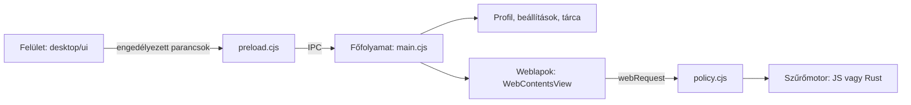

# Architektúra

## Asztali alkalmazás (Electron)

- **Felület** (`desktop/ui`) – helyi HTML, CSS és JavaScript szigorú CSP mellett.
  A `renderer.js` a főfolyamattól kapott állapotból rajzol; minden művelet egy
  előre megadott parancslistán (`preload.cjs`) keresztül megy a főfolyamathoz.
- **Főfolyamat** (`desktop/main.cjs`) – ablakok, lapok, munkamenetek, letöltések,
  bővítmények és frissítés. A témakörönkénti logika a `desktop/core` moduljaiban
  van, ezek Node-ból önállóan tesztelhetők.
- **Weblapok** – `WebContentsView`-ban futnak (`sandbox`, `contextIsolation`, Node
  nélkül). A felület átfedő elemei (menük, panelek) idejére a weblap nézete
  ideiglenesen elrejtődik, és egy pillanatkép kerül a helyére.

### Állapot a felület felé

A főfolyamat minden változáskor egy pillanatképet küld (`snapshot()`), amelyet a
felület egy lépésben jelenít meg. A nagy, ritkán változó részek (előzmények,
webhelyikonok) csak akkor kerülnek bele, ha változtak; a felület megtartja a korábbi
példányt. A gyakori események (például blokkolt kérések) 200 ms-onként összevonva
jutnak el a felülethez.

### Munkamenetek

| Mód          | Tárolás                                                            |
| ------------ | ------------------------------------------------------------------ |
| Normál       | Tartós session (`persist:tracer-default`), könyvjelzők, előzmények |
| Privát       | Ablakonként külön, nem tartós session                              |
| Live Sandbox | Külön, nem tartós session; tárca, engedélyek és letöltések nélkül  |
| Tor          | Külön, nem tartós session, kizárólag helyi SOCKS5 proxyn át        |

Az inaktív lapok (időkorlát, Surge vagy kézi altatás) nézete felszabadul, az URL
megmarad; aktiváláskor újratöltődnek. A munkamenet újraindításkor visszaáll, az
alvó lapok csak megnyitáskor töltenek be.

### Hálózati döntések

A `policy.cjs` minden kérésnél ebben a sorrendben dönt:

1. érvénytelen cím vagy tiltott séma elutasítása;
2. altatott lap és Quiet Lease;
3. HTTPS-Only (GET/HEAD feljavítás, egyéb titkosítatlan kérés tiltása);
4. webhelyenkénti scripttiltás és Context Fence;
5. szűrőlista;
6. követő URL-paraméterek eltávolítása.

A szűrő alapból a beépített JavaScript-motor; ha a lefordított Rust modul
(`native/tracer-adblock`) jelen van, az adblock-rust motor dolgozik.

### Adatok és titkosítás

- A profil a felhasználói mappa `profile.json` fájljában van, atomikus írással.
- Jelszavak: az Electron `safeStorage` (Windows alatt DPAPI) titkosítja a teljes tárat.
- Tárca: titkosított fájl; minden webhelykérés külön jóváhagyást kér.
- Szinkron: scrypt kulcsképzés és AES-256-GCM. A relay csak titkosított adatot
  lát. Az Android és iOS kliens ugyanazt a formátumot használja.

## Android

- `BrowserActivity` – a teljes felület; minden lap egy rendszer-WebView.
- `HomePage` – a kezdőlap HTML-je szkriptek és külső erőforrások nélkül.
- `BrowserUi` – a natív vezérlők (gombok, sorok, lapok) közös építőkövei.
- A privát munkamenet külön `:private` folyamatban fut saját WebView-adatokkal.
- `BrowserMediaService` – háttérben lejátszás médiavezérlőkkel.
- `AppUpdater` és `PackageSessionInstaller` – frissítés GitHub-kiadásokból.

## iOS

SwiftUI felület `WKWebView` motorral (`mobile/ios`). A privát mód nem tartós
adattárat használ, a reklámszűrést WebKit content-rule lista végzi.

## Tesztek

- `npm test` – a `desktop/core` modulok, a szinkron, a frissítési szabályok és a
  weboldal-építő unit tesztjei.
- `npm run test:browser` – a teljes böngésző integrációs tesztje valódi Electron
  ablakkal (`desktop/smoke.cjs`). A képernyőképek az ideiglenes mappába kerülnek,
  vagy a `TRACER_SMOKE_OUTPUT` által megadott helyre.
- Android: `gradle :app:testPreviewUnitTest` a `mobile/android` mappában.
