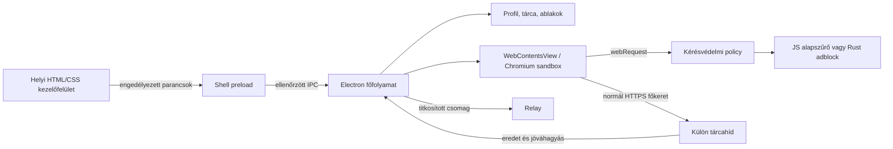

# Tracer architektúra

A Tracer 0.3.2 kódalapja egy Electron/Chromium Windows-böngészőből, opcionális Rust hálózati szűrőből, önálló Kotlin és Swift mobilkliensekből, titkosított adatcsere-protokollból és két Windows telepítőből áll. A saját böngészőfelület és vezérlés meg van írva; a Chromium C++ motorját az Electron szállítja. Saját Chromium-fork, teljes Brave-funkcióazonosság és saját mobil Chromium-port nincs ebben a kiadásban.

Az Electron többfolyamatos modelljében a főfolyamat kezeli a natív képességeket, a renderelők a webes tartalmat. A Tracer erre a felosztásra épül. [Electron process model](https://www.electronjs.org/docs/latest/tutorial/process-model)

## Projektstruktúra és belépési pontok

```text
Tracer/
├── package.json, package-lock.json        # Windows függőségek és csomagolás
├── assets/
│   ├── tracer.svg                        # Fekete, vektoros márkajel
│   ├── tracer.png, tracer.ico            # Generált Windows ikonok
│   ├── tracer-1024.png, logo-preview.html
│   ├── sites/{kisskorboy,overclock,solaryn,solarcenter,asthetic,kounee}.png
│   └── wallpapers/                       # Offline CC0-képek, katalógus és előnézetek
├── desktop/
│   ├── main.cjs                          # Electron főfolyamat, ablakok, IPC
│   ├── preload.cjs                       # Korlátozott shell-parancshíd
│   ├── content-preload.cjs               # Elkülönített webes tárcahíd
│   ├── smoke.cjs                         # Valós Chromium ellenőrzés
│   ├── ui/{index.html,styles.css,renderer.js,appearance.js}
│   └── core/
│       ├── url.cjs, rules.cjs, policy.cjs # Címek és kérésvédelem
│       ├── store.cjs, heatmap.cjs         # Profil és lapkezelés
│       ├── profile-state.cjs              # Normál összesítők és korlátozott lapvisszaállítás
│       ├── browser-import.cjs             # Export/profil parserek, ablakhoz kötött előnézet
│       ├── passwords.cjs                  # OS-kulcstárral titkosított mentett fiókok
│       ├── favicons.cjs                   # Sessionhöz kötött ikonok, PNG-transzkódolás
│       ├── context-menu.cjs               # Képműveletek és forrásellenőrzés
│       ├── tor.cjs                        # Kezelt Tor folyamat, SOCKS5 és életciklus
│       ├── extensions.cjs                 # Bővítményengedélyek, csomagimport és életciklus
│       ├── chrome-store.cjs               # Hivatalos letöltés, CRX3 és korlátos ZIP-kibontás
│       ├── appearance.cjs                # Validálás, helyi képek, importkorlátok
│       └── sync.cjs, wallet.cjs           # Titkosítás és tárca
├── native/
│   ├── Cargo.toml, build.ps1, README.md
│   ├── adblock-core/{Cargo.toml,src/lib.rs}
│   └── tracer-adblock/
│       ├── Cargo.toml, build.rs, src/lib.rs
│       ├── index.d.ts, smoke-test.cjs
│       └── tracer_adblock.node            # Opcionális build-eredmény
├── shared/
│   ├── config.json                       # Windows témák és adatvédelmi alapértékek
│   ├── appearance.json                   # Kanonikus témák, kiemelések, gyorslinkek
│   └── filters/                          # Core + EasyList/EasyPrivacy snapshot, eredet és licencek
├── mobile/
│   ├── README.md
│   ├── android/
│   │   ├── settings.gradle.kts, build.gradle.kts, gradle.properties
│   │   └── app/
│   │       ├── build.gradle.kts, proguard-rules.pro
│   │       ├── src/main/
│   │       │   ├── AndroidManifest.xml
│   │       │   ├── java/app/tracer/mobile/
│   │       │   │   ├── TracerApplication.kt
│   │       │   │   ├── BrowserActivity.kt
│   │       │   │   ├── Appearance.kt      # Natív mobilpaletták és képimport
│   │       │   │   ├── PrivateGhostReceiver.kt
│   │       │   │   └── SyncClient.kt        # Kézi E2EE wire-adapter
│   │       │   ├── assets/shields.json
│   │       │   └── res/{drawable,values,xml}/
│   │       └── src/androidTest/             # Szinkron fixture és eszközteszt
│   ├── ios/
│   │   ├── project.yml, ExportOptions.plist
│   │   ├── TracerTests/                     # Szinkron interoperabilitási forrás
│   │   └── Tracer/
│   │       ├── TracerApp.swift, BrowserModel.swift, BrowserScreen.swift
│   │       ├── SyncClient.swift, SyncSettingsScreen.swift
│   │       ├── Appearance.swift, AppearanceScreen.swift
│   │       ├── Info.plist
│   │       └── Resources/{content-blocker.json,Assets.xcassets}/
│   └── testing/sync-vector.json            # Közös E2EE tesztvektor
├── installer/
│   ├── README.md
│   ├── nsis/tracer.nsh
│   └── bootstrapper/
│       ├── Tracer.Setup.csproj, App.xaml, App.xaml.cs
│       ├── MainWindow.xaml, MainWindow.xaml.cs
│       ├── ReleaseClient.cs, Authenticode.cs
│       └── release-config.json, app.manifest
├── sync/server.cjs                       # Helyi fejlesztői relay
├── scripts/{appearance.mjs,check.mjs,icons.mjs,site-icons.cjs,wallpapers.py,package-windows.mjs,test-packaged.mjs}
├── tests/{appearance.test.cjs,backend.test.cjs,chrome-store.test.cjs,extensions.test.cjs,profile-state.test.cjs,passwords.test.cjs,privacy.test.cjs,wallet.test.cjs,grouping.test.cjs,sync-vector.test.cjs}
└── docs/{ARCHITECTURE.md,FEATURES.md,APPEARANCE.md,IMPORT.md,EXTENSIONS.md,CHROME_COMPATIBILITY.md,VALIDATION.md}
```

A `node_modules`, `dist`, a .NET `bin/obj` és az ellenőrzési `artifacts` generált tartalom. A mobil build és aláírás külön eszközkészletet igényel; a Rust addont a Windows-kliens csak elkészült `.node` fájl esetén tölti be. A részletes platformparancsok a [mobil](mobile/README.md), [natív](native/README.md) és telepítő (`../installer/README.md`) leírásban vannak.

## Windows: bizalmi határok



A shell helyi, csomagolt HTML-t tölt be, szigorú CSP-vel. A címek, oldalcímek és importált elemek szöveges DOM-csomópontokként jelennek meg. A shell nem navigálhat el a kezelőfelületről. A parancshíd előre megadott parancsokat fogad; a főfolyamat ellenőrzi a küldő `WebContents`-t, a főkeretet és a shell pontos fájl-URL-jét.

A külső weboldalak `WebContentsView`-ban futnak: `nodeIntegration:false`, `contextIsolation:true`, `sandbox:true`, `webSecurity:true`, tiltott mixed content mellett. Nem kapják meg a böngésző shell-parancsait. A normál profil külön, szűk tárcahidat kap; privát, Tor és sandbox módban ez a preload hiányzik. A renderer sandbox nem helyettesíti a rendszeres Electron/Chromium frissítést és az IPC ellenőrzését. [Electron security](https://www.electronjs.org/docs/latest/tutorial/security)

A webes engedélyek kezdetben tiltottak. Normál ablakban egyes képességek felhasználói párbeszéddel engedélyezhetők, az adott tartalomhoz és eredethez kötve. A navigáció, az ablak bezárása és a Ghost alatt függő kéréseket a főfolyamat újraellenőrzi. A képernyőmegosztás tiltott.

## Munkamenetek és lapok

A `profile-state.cjs` két elkülönített adatot normalizál. A globális számlálók csak a normál profil request-policy döntéseiből növekednek, webcímek nélkül, és több ablakból ugyanazt az összesítőt frissítik. A munkamenetmentés csak normál ablakok URL-jét, címét, aktív lapját, rögzítését, némítását és zoomját tartja meg. A `restoreSession` alapból igaz; a korábbi profilban hiányzó választás is ezt kapja. A mentést 800 ms-os összevonás korlátozza, lezáráskor és kilépéskor véglegesül; az utolsó normál ablak is megmarad visszaállíthatóként. Az inaktív visszatöltött lapoknak nincs Chromium-nézetük a kiválasztásig. Ghost üríti a mentett laplistát, az összesített számlálókat megőrzi.

| Mód          | Tárolás és szerep                                                                           |
| ------------ | ------------------------------------------------------------------------------------------- |
| Normál       | Tartós Electron session, helyi könyvjelzők és előzmények                                    |
| Privát       | Ablakonként egyedi, nem `persist:` session; az ablak lapjai közös privát profilt használnak |
| Live Sandbox | Külön, nem tartós session; tárcahíd, webes engedélyek és letöltések nélkül                  |
| Tor          | Külön, nem tartós session; csomagolt vagy külső helyi SOCKS5 proxyhoz rögzített hálózat     |

A session-partíciók a cookie-kat és a webhelyadatokat különítik el. Nem bizonyítják, hogy két lap külön OS-folyamatot kap, és a Live Sandbox nem virtuális gép vagy Windows AppContainer. A Chromium saját processz- és site-isolation döntései külön réteget alkotnak. [Electron session](https://www.electronjs.org/docs/latest/api/session), [Chromium site isolation](https://www.chromium.org/developers/design-documents/site-isolation/)

Az inaktív nézetek időkorlát, Surge vagy kézi altatás miatt megsemmisíthetők. A lap URL-je megmarad; ébresztéskor újra betöltődik. Ez felszabadítja a webnézet erőforrásait, de elveszítheti a nem mentett űrlapokat és a megsemmisített nézet navigációs előzményeit. Normál fülváltáskor a meglévő nézet megtartja a back-stacket.

A rögzítés, némítás és zoom a lapmodellben él; némításkor a tényleges Chromium nézet hangja is változik. Duplikáláskor új lap tölti be az URL-t. Az ablakonkénti újranyitási verem legfeljebb 20 bezárt lap URL-jét, címét és néhány megjelenési állapotát tartja RAM-ban. Nem ment DOM-ot, űrlapot, cookie-t vagy navigációs back-stacket; Ghost és ablakbezárás után nem állítható vissza.

A Ghost először leállítja a lapokat és letöltéseket, zárolja a tárcát, törli az engedélyeket és az újranyitási vermeket. Ezután lezárja a session-kapcsolatokat, törli a cookie-kat, webhelytárakat, cache-eket és hitelesítési cache-t, valamint a helyi előzményeket és webhelyszabályokat. A normál profil a kiürített, stabil `persist:tracer-default` partícióval folytatódik, így a következő alkalmazásindítás ugyanazt a kiürített profilt használja. A könyvjelzők, megjelenési beállítások, saját háttérképek, titkosított tárcafájl, a titkosított fióktár, a globális összesítők és már lementett felhasználói fájlok megmaradnak. A művelet logikai profilürítés; SSD-, swap-, hálózati vagy külső mentések forenzikus törlését nem valósítja meg.

## Megjelenés, helyi képek és böngészővezérlés

A `shared/appearance.json` az asztali paletták, kiemelőszínek és alapgyorslinkek közös forrása. A `scripts/appearance.mjs` ebből állítja elő a `desktop/ui/appearance.js` helyi UI-adatfájlt. A főfolyamat közvetlenül a JSON-katalógust használja az azonosítók ellenőrzésére. Az npm indítási, ellenőrzési és Windows build hookok újragenerálják az adatokat; a generált fájl közvetlen szerkesztése elveszik a következő generáláskor.

A `shared/config.json` alapértékeit a `Store` normalizálja; a választás a profil `profile.json` fájljába kerül. A `validateAppearance` kizárólag ismert mezőt, katalógusazonosítót és megfelelő típust fogad: 0–85 sötétítés, logikai kapcsolók, valamint `system/full/reduced` mozgásmód. Az örökölt világos téma Cloudra migrál. A rendszertéma az OS világos/sötét jelzését követi. A shell CSS-változói valódi felületi, szöveg-, keret- és hover-színeket módosítanak; a weboldal témáját nem írják át.

Az `appearance.hiddenShortcuts` külön, alapból üres tömb. Legfeljebb a hat beépített promóció pontos URL-jét fogadja, ismétlődés nélkül; más cím vagy hibás típus elutasítja a teljes megjelenési patch-et. A validáló másolatot készít a tömbről, a profil pedig az általános beállításmentéssel tartósítja. A renderer a kezdőlap, könyvjelzősáv, helyi címsorjavaslatok és parancspaletta promóciós hozzájárulását szűri. Azonos című saját könyvjelző megmarad, az előzmények sem változnak. A sáv renderelési aláírása a preferenciát is tartalmazza, így a változás azonnal érvényesül. Ghost a megjelenési választásokkal együtt ezt is megőrzi.

A `WallpaperLibrary` a mellékelt képeket az `assets/wallpapers/catalog.json` katalógusból olvassa, saját importjait az Electron `userData/wallpapers` könyvtárába menti. A kliens képazonosítót küld, tetszőleges olvasási útvonalat nem. Az import kizárólag normál ablakból, natív fájlválasztóval indul. A bájt- és képméret ellenőrzése a dekódolás előtt történik: JPEG/PNG/WebP, legfeljebb 25 MiB és 60 megapixel. A natív dekóder az eredményt aránytartóan legfeljebb 3840×2160-ra csökkenti és JPEG-ként újrakódolja, eredeti képmetaadatok nélkül. Legfeljebb 10 saját kép lehet; az import párhuzamos indítása tiltott. A generált fájlnevek és útvonalellenőrzések megakadályozzák a könyvtárból kilépést és a szimbolikus link követését.

A 0.3.2 mellékelt galériája helyben csomagolt, CC0 forrású képekkel váltja le a korábbi öt felhasználói képet; a katalógus rögzíti az aktuális képazonosítókat, forrásokat és felbontásokat. A galéria külön kis JPEG-előnézeteket használ. A választott nagy kép helyi adat-URL-ként jut a shellhez, és csak váltáskor töltődik be. A kezdőlap nem kér külső favicont vagy háttérképet. Aszinkron importnál a Ghost/navigációs állapot újraellenőrzése akadályozza meg a visszavont művelet mentését. A teljes felhasználói beállításleírás az [APPEARANCE.md](APPEARANCE.md) fájlban található.

A `Ctrl+K` paletta és a címsorjavaslatok helyi adatokat szűrnek, keresőszolgáltatói gépelési lekérdezés nélkül. Az Enterrel elküldött keresés a kiválasztott keresőhöz navigál. A `Ctrl+F` a Chromium `findInPage` API-ját hívja; az eredmény aktív laphoz és kérésazonosítóhoz kötött. A zoom 50–200% közé korlátozott. A PNG-képernyőkép a látható nézetből készül, natív mentési párbeszéddel; a főfolyamat a párbeszéd és a capture után is ellenőrzi az aktuális lapot, dokumentumverziót és Ghost-generációt.

A natív webnézet felső határát a könyvjelzősáv és a keresősáv tényleges megjelenése számítja. A shell átfedő paneljei ideiglenesen elrejtik a webnézetet. Minden lapművelet a küldő shell és az adott ablakhoz tartozó lap ellenőrzésén megy át, továbbá azonosító-, típus-, szöveghossz- és értéktartomány-korlátokat alkalmaz. A 150–160 ms CSS-átmenetek a rendszer csökkentett mozgás beállítását tiszteletben tartják; nincs folyamatos UI-animációs ciklus.

## Hálózati döntések

A címkezelő csak HTTP/HTTPS navigációt fogad, elutasítja a beágyazott felhasználónevet/jelszót és a privilegizált sémákat. A szöveges keresést URL-paraméterként kódolja; az alapkereső Google. A kérés-policy támogatja a HTTP/HTTPS és WebSocket hálózati sémákat.

A `policy.cjs` döntési sorrendje:

1. Érvénytelen cím vagy tiltott séma elutasítása.
2. Altatott lap és Quiet Lease ellenőrzése.
3. HTTPS-Only: GET/HEAD esetén feljavítás HTTPS/WSS-re; nem idempotens HTTP-kérésnél tiltás, automatikus POST-újraküldés nélkül. A pontos loopback hosztok fejlesztői kivételek.
4. Script-tiltás és Context Fence.
5. Hálózati szűrő; a főnavigációt ez az adapter nem blokkolja listaalapon.
6. Ismert követési URL-paraméterek törlése GET/HEAD esetén.

A döntés a Chromium-kérés folytatása előtt születik. Egy session-höz egy összefogott Tracer handler tartozik. [Electron WebRequest](https://www.electronjs.org/docs/latest/api/web-request)

A webhelyenkénti script-blokk a hálózati scriptkéréseket tiltja, és a válaszhoz egy további `script-src 'none'; object-src 'none'` CSP-t rendel az inline végrehajtás ellen. A webnézet `javascript:true` beállítása végig megmarad; a kapcsoló nem egy létrehozáskor rögzített JavaScript-preferenciát próbál utólag átírni. Változtatáskor újratöltés történik. Az inline script tiltását és visszaengedését valódi Chromium-integrációs ellenőrzés igazolta.

A Quiet Lease a háttérbe kerülő lap deaktiválásakor frissíti a `lastActive` időbélyeget, ezért a 30 másodperces újkérés-bérlet a tényleges háttérbe kerüléstől számít. Aktiváláskor újra frissül. Ez kérésenkénti policy, nem meglévő streamek vagy socketek automatikus lezárása.

A JS alapszűrő csak az explicit támogatott domain-, típus-, party- és kivételszabályokat értelmezi; ismeretlen szintaxist eldob. A Rust addon az adblock-rust hálózati motorját használja, PSL-alapú party szemantikával. A motor szálhoz kötött, szinkron és saját `unsafe` implementáció nélkül integrált. Natív kérésfeldolgozási hiba esetén a desktop adapter tilt. Scriptletek és redirect-erőforrások nincsenek bekötve. [adblock-rust](https://github.com/brave/adblock-rust), [Engine API](https://docs.rs/adblock/0.13.3/adblock/struct.Engine.html)

A DoH a Chromium resolverét konfigurálja. A Node `fetch` és az ethers RPC kapcsolat külön hálózati út; a jelenlegi Chromium DoH-beállítás ezekre nem általános garancia. Tor/privát/sandbox ablakból a tárca hálózati lekérdezése és a szűrőletöltés tiltott. A Tor-session explicit helyi SOCKS5 proxyt használ közvetlen fallback nélkül. A csomagolt Tor motor saját ideiglenes adatmappát és véletlen helyi SOCKS portot kap; a `Bootstrapped 100%` naplóüzenetet valódi kézfogás követi. Futó helyi 9050/9150 proxy is felismerhető. Ghost, megszakítás, utolsó Tor-ablak bezárása és kilépés a saját motort állítja le. Tor Browser fingerprint-egységesítés és auditált teljes anonimitási réteg nincs. Részletek: [TOR.md](TOR.md).

## Bővítmények

Az `ExtensionManager` a normál Chromium session bővítmény API-ját használja. A két helyi katalóguscsomag és a natív párbeszéddel kiválasztott import ugyanazon előnézeten, engedélyjóváhagyáson és korlátos csomagellenőrzésen megy át. A másolat a profil saját `extensions` könyvtárába kerül, a registry pedig a kapcsolók állapotát és a jóváhagyott manifest ellenőrzőösszegét tárolja. Induláskor a csomagok betöltése megelőzi a normál lapok visszaállítását.

A 0.3.2-ben a `chrome-store.cjs` adja a hivatalos Chrome Web Store letöltési utat. A főfolyamat `chromeStorePage` snapshotmezője csak a normál aktív lap ellenőrzött áruházi részletoldalához ad kanonikus linket; ez jeleníti meg a shell saját **Hozzáadás a Tracerhez** gombját. A helyi panel `extension-install-web-store` parancsa URL-t fogad, tetszőleges csomagútvonalat nem. A külső áruházi oldal nem kap Tracer IPC-hozzáférést.

A csomag kizárólag a megengedett Google HTTPS frissítési végpontokról érkezhet, idő-, bájt- és átirányítási korlátokkal. A CRX3 ellenőrzés a tényleges RSA/ECDSA aláírásokra, a rögzített áruházi igazolásra és a fejlesztőkulcsból számított bővítményazonosítóra épül. A ZIP-parser ellenőrzi az útvonalakat, tényleges kibontott méreteket, fájlszámot és könyvtármélységet. A csomag ideiglenes staging könyvtárban vár; a kötelező, nem támogatott API-igények ellenőrzése és natív engedélyjóváhagyás után kerül a profilba. A művelet egyetlen függő áruházi telepítésre korlátozott; a megszakítás az indító ablakhoz kötött, ablakbezárás, kilépés és Ghost is visszavonja. A jóváhagyás utáni másolás ismét ellenőrzi a manifestet és a csomag tartalmát.

A registry az áruházi azonosítót, kanonikus forrás-URL-t, eredeti csomag- és kibontott tartalomellenőrzőösszeget is tárolja. A később módosított csomag új jóváhagyást igényel; automatikus áruházi frissítés nincs. Az ideiglenes letöltés törlődik a művelet végén; takarítási hiba külön figyelmeztetés, nem változtat egy már sikeres telepítést hibás eredménnyé.

A felugró bővítményfelület külön sandboxolt `BrowserWindow`, saját `chrome-extension://` eredetre korlátozott navigációval, Node.js és Tracer IPC nélkül. Ghost, eltávolítás és kikapcsolás bezárja a kapcsolódó felületeket; Ghost a korábban telepített csomagokat megtartja. A privát, Tor és sandbox session nem tölt bővítményt. Az Electron API-támogatása részleges; a CRX3 hitelessége és a sikeres telepítés nem igazolja a bővítmény teljes működését. **A Proton Pass jelenleg nem támogatott**, a szükséges API-hiányok miatt telepítése elutasított. Chrome témák sem telepíthetők. Használat: [EXTENSIONS.md](EXTENSIONS.md); a mért hiányok és a teljesebb motorintegráció feltételei: [CHROME_COMPATIBILITY.md](CHROME_COMPATIBILITY.md).

## Mobil motorok és izoláció

Androidon a belépési pont a `TracerApplication`, a felület a `BrowserActivity`, a motor a rendszer Chromium-alapú WebView-ja. A privát Activity külön `:private` folyamatban fut, és a WebView első használata előtt külön adatkönyvtár-suffixet kap. A korábbi privát profilt a következő privát process-indulás törli. Kényszerleállítás után addig maradhatnak lemezadatok; ez nem memóriában tartott privát profil. [Android WebView](https://developer.android.com/develop/ui/views/layout/webapps/webview), [adatkönyvtár API](<https://developer.android.com/reference/android/webkit/WebView#setDataDirectorySuffix(java.lang.String)>)

iOS-en a `TracerApp` SwiftUI belépési pont, a `BrowserModel` tartja a füleket, a `BrowserScreen` a kezelőfelület. A motor `WKWebView`, a privát adatforrás `WKWebsiteDataStore.nonPersistent()`. A mellékelt JSON listából a WebKit natív content-rule listát fordít. Ez önálló WebKit-integráció; nincs Chromium-backend vagy alternatív motor entitlement. [WKWebView](https://developer.apple.com/documentation/webkit/wkwebview), [WebKit content blockers](https://webkit.org/blog/3476/content-blockers-first-look/)

A mobilkliensek alsó címsort, fülkezelést, adatkímélőt, privát biometrikus zárolást, Ghost műveletet és kézi E2EE szinkronfelületet tartalmaznak. Az `Appearance.kt` és `Appearance.swift` nyolc natív palettát, rendszermódot, saját képimportot és a hat közös gyorslinket adja; ez nem a desktop teljes megjelenési modulja. Saját mellékelt szűrőik vannak; a Rust adapter nincs bekötve. Az Android `SyncClient.kt`, illetve az iOS `SyncClient.swift` ugyanazt az envelope- és payload-sémát használja, mint a desktop. A mobil forráskód megléte nem jelent APK/IPA fordítási, cross-platform futtatási vagy fizikai eszközön végzett ellenőrzést.

## Tárca és titkosított adatcsere

A desktop tárca EVM kulcsot és Solana Ed25519 seedet tárol titkosított fájlban. EVM cím, egyenleg, üzenetaláírás és külön jóváhagyott tranzakcióküldés van implementálva. Solanán cím, egyenleg és üzenetaláírás érhető el; Solana tranzakcióaláírás és -küldés nincs. A webhelyazonosságot a főkeret HTTPS eredete, a kapcsolódási engedély és a művelet előtti párbeszéd ellenőrzi. A vault generációs számlálója visszavonja a függő feloldást/aláírást zároláskor; tranzakció broadcast előtt újraellenőrzés történik. A már broadcastolt tranzakció visszavonása nem helyi zárolási művelet. [ethers Wallet API](https://docs.ethers.org/v6/api/wallet/)

A szinkroncsomag `v:1` sémával normál könyvjelzőket, előzményeket és lap-URL-eket tartalmaz. A jelszóból scrypt `N=32768,r=8,p=1` képez 32 bájtos kulcsot, 16 bájtos véletlen salttal. AES-256-GCM, 12 bájtos nonce, 16 bájtos tag és `tracer-sync-v1` AAD védi a csomagot. A relay bearer tokennel hitelesít, a tartalmat nem fejti vissza. A kliens legfeljebb 2 900 000 bájtos plaintextet és 4 000 000 bájtos wire-választ kezel; túllépéskor megszakítja a streamet. [Node crypto](https://nodejs.org/api/crypto.html)

Androidon a Bouncy Castle 1.83 `SCrypt` adja a kulcsderiválást, a rendszer `AES/GCM/NoPadding` Cipher a titkosítást. iOS-en a rögzített CryptoSwift 1.10.0 csomag `Scrypt` KDF-je és a rendszer CryptoKit `AES.GCM` implementációja működik együtt. A scrypt-paraméterek, az AAD, a salt/nonce/tag hossza és a base64 envelope közös; közös Node-eredetű fixture és mobil interoperabilitási tesztforrás is tartozik hozzá. Ezek mobilon még nem futtatott ellenőrzések. [Bouncy Castle Java](https://www.bouncycastle.org/documentation/documentation-java/), [CryptoSwift](https://github.com/krzyzanowskim/CryptoSwift), [CryptoKit AES.GCM](https://developer.apple.com/documentation/cryptokit/aes/gcm)

Távoli relayhez HTTPS kell; desktopon HTTP csak pontos loopbacken megengedett, mobilon ehhez debug build és külön helyi engedély is szükséges. A kliensek nem követik a relay átirányításait. A megírt protokoll kézi Windows/Android/iOS feltöltés/letöltés: a letöltés lecseréli a könyvjelző- és előzmény-snapshotot, a távoli lapokat pedig választható listaként kínálja. Windows-on a folyamat ellenőrzött, a mobil wire-adapterek és UI-k még nem fordított források. Nincs automatikus szinkron, eszközpárosítás, automatikus konfliktus-összefésülés, replay-védelem vagy távoli Ghost-törlés. A relay láthatja a kapcsolat metaadatait és visszaadhat korábbi, érvényes titkosított snapshotot. A normál profil könyvjelzői és előzményei helyben egyszerű JSON-ban vannak; az E2EE a relayhez küldött csomagot védi.

## Helyi böngészőimport és jelszótár

A `browser-import.cjs` kizárólag az interaktívan kiválasztott forrásokat olvassa. A Windows Brave/Chrome/Edge profilokhoz a főfolyamat ad véletlen azonosítót; a renderer nem adhat be tetszőleges profilútvonalat. Exportfájlnál a natív fájlválasztó jelöli ki a forrást. A parser ellenőrzi a fájl típusát, méretét, protokollját és rekordkorlátait; a History SQLite-olvasó csak olvasásra, kiterjesztésbetöltés nélkül működik. Titkosított Chromium Login Data vagy munkamenet visszafejtése és cookie-import nincs. A konkrét forrástámogatás: [IMPORT.md](IMPORT.md).

Az `import-preview` csak darabszámokat, figyelmeztetéseket és egy öt percig érvényes tokent ad a shellnek. A legfeljebb négy függő előnézet adatai a főfolyamat RAM-jában, ablakhoz és Ghost-epochhoz kötve várnak. Az `import-commit` ellenőrzi az egyszer használható tokent és a kiválasztott adattípusokat; az importált háttérlapok késleltetve kapnak nézetet. Ablakbezárás, lejárat és Ghost törli a függő előnézetet. A renderer nem kap CSV-jelszót vagy teljes fiókrekordot.

A `PasswordVault` az Electron `safeStorage` adapterét kapja a főfolyamattól. A lemezre kerülő `passwords.json` kizárólag verziót és base64-kódolt titkosított bájtokat tartalmaz, az eredetek és felhasználónevek is a titkosított részben vannak. A tár legfeljebb 1000 rekord és 8 MiB világos szövegű payload lehet. Importkor a teljes csomag validálódik és titkosítódik, majd egy átlátszatlan előkészített token egyetlen atomi átnevezéssel menthető. A token a fájl revízióját is ellenőrzi; a sérült vagy nem visszafejthető korábbi tár nem válik üres tartalékká. Ghost visszavonja az előkészített tokeneket, a szándékosan mentett fiókokat megőrzi.

Windows alatt az OS-védelem DPAPI-ra épül; Linuxon a `basic_text` és az ismeretlen rendszerkulcstár nem használható. A DPAPI más helyi Windows-felhasználó ellen ad védelmet, az azonos felhasználóként futó más program elleni teljes elkülönítést nem biztosítja. [Electron safeStorage](https://www.electronjs.org/docs/latest/api/safe-storage)

A metadata-lista csak explicit fiókművelet kérésére fejthető vissza. A `credential()` kizárólag belső főfolyamati művelet: pontos HTTPS eredethez ad ideiglenes kitöltési adatot. A kitöltés Chromium isolated worldben, a főkeretben történik, nem jár iframe-be és nem küldi el az űrlapot. A főfolyamat az aktív lapot, eredetet, navigáció-revíziót és Ghost-epochot a végrehajtás előtt és után ellenőrzi. A jelszó nem kerül snapshotba vagy IPC-válaszba. A másolás explicit vágólapművelet; a mentett fióktár nem része az E2EE szinkroncsomagnak.

## Terjesztés és ellenőrzés

A Windows NSIS csomag telepíti a böngészőt és a parancsikonokat; a 0.3.2 csomagolási cél `dist/Tracer-Setup-0.3.2-x64.exe`. A Tor motor a `resources/tor` könyvtárban, az ASAR-on kívül helyezkedik el, a hozzá tartozó forrásokkal és licencekkel. A helyi `--unsigned` build aláíratlan. A WPF bootstrapper aláírt kiadási manifestet, méretet, SHA-256-ot és rögzített Authenticode kiadót ellenőriz, majd az NSIS-t indítja. A letöltős konfiguráció alapból letiltott, amíg a kiadó meg nem adja a saját HTTPS szolgáltatását és kulcsait; az aláíratlan helyi NSIS-build nem felel meg ennek az éles letöltési követelménynek. Androidhoz APK/AAB, iOS-hoz Xcode archive és aláírt IPA build-folyamat tartozik.

A Node tesztek a kérés-policyt, URL-kezelést, kriptográfiát, tárcaversenyhelyzeteket, helyi csoportosítást, megjelenési validálást és képimportkorlátokat vizsgálják. A valódi Electron/Chromium smoke külön ellenőrzi a shell működését, izolációt, hálózati szűrést és Ghost viselkedést. Az aktuális tesztszámok, új UI-funkciók ellenőrzései és a csomagolási eredmények a [VALIDATION.md](VALIDATION.md) fájlban szerepelnek, a gépi smoke-eredmény az `artifacts/browser-smoke.json` fájlban található. A telepítő elkészülése és a Chromium smoke nem jelent tiszta gépen végzett telepítés/eltávolítási ellenőrzést. A Rust és mobil build/eszközteszt továbbra is külön feladat; ez a tesztcsomag nem teljes böngésző- vagy tárcaaudit.

## Fenyegetési modell és következő fejlesztési szakaszok

Védett értékek: normál és privát webhelyadatok elkülönítése, engedélyek, tárcakulcsok, explicit jóváhagyás és relay-tartalom. Támadó lehet rosszindulatú weboldal, iframe, módosított relay-csomag vagy kompromittált kiadási végpont. A root/admin jogú helyi támadó, a kompromittált operációs rendszer és az ismeretlen Chromium exploit elleni teljes védelem nincs bizonyítva.

| Szakasz                  | Konkrét munka és elfogadási feltétel                                                                                                                                                                                                                                               |
| ------------------------ | ---------------------------------------------------------------------------------------------------------------------------------------------------------------------------------------------------------------------------------------------------------------------------------- |
| Motorfrissítés és kiadás | Támogatott Electron-verziók követése; lockfile és SBOM; aláírt kiadás, tiszta Windows telepítés/eltávolítás; saját CI x64/ARM64 és mobil build-mátrix                                                                                                                              |
| Natív szűrés             | Cargo build és a Rust/Node corpus futtatása; valódi EasyList regressziók; iframe-initiátorok és PSL szemantika ellenőrzése; nagyméretű listák indulási és p95 match-idő mérése                                                                                                     |
| Teljes content blocking  | URL-függő kozmetikai szabályok, dinamikus DOM és auditált helyi resource/scriptlet készlet; külső listák nem adhatnak tetszőleges privilegizált kódot                                                                                                                              |
| Fingerprint-hardening    | Saját upstream-követett Chromium/Blink patch-réteg Canvas/WebGL/audio és worker API-khoz; eredethez/sessionhöz kötött konzisztens változtatás; iframe/OffscreenCanvas/worker regressziók és valós webes kompatibilitásmérés. Preload spoofingot nem tekintünk kész motorvédelemnek |
| Hálózati egységesítés    | Node/RPC és Chromium utak közös resolver/proxy politikája; DNS-, WebRTC- és proxykiesési tesztek hálózati capture-rel; secure DoH-nál nincs észrevétlen plaintext fallback                                                                                                         |
| Erősebb sandbox          | Minimális brokerrel kezelt Windows AppContainer vagy külön folyamat; explicit fájl-, clipboard-, eszköz- és hálózati engedélyek; rosszindulatú tartalommal végzett negatív tesztek                                                                                                 |
| Tor-integráció           | Ellenőrzött daemon-csomag, hitelesített vezérlés, circuit/session izoláció és DNS-leak tesztek; routing és fingerprint eredmények nélkül nem használható Tor Browser-szintű állítás                                                                                                |
| Mobil paritás            | Android Rust/JNI adapter és iOS content-rule fordítás; eszközön privát crash-recovery, biometria és WebRTC tesztek; WKWebView API-k tényleges korlátainak megtartása                                                                                                               |
| Szinkron v2              | A megírt mobil adapterek fordítása és közös fixture-tesztjeinek futtatása; majd eszközpárosítás, verziózott rekordok, authenticated revision, replay-védelem, konfliktusok és visszavonás                                                                                          |
| Tárca és jelszavak       | A megírt OS-kulcstáras fióktár további forma- és kompatibilitási tesztjei, hardveres/biometrikus feloldás, jóváhagyási fuzz és race-tesztek; Solana tranzakciópipeline külön specifikációval                                                                                       |

A jelenlegi automatikus csoportosítás helyi TF-IDF címvektorokat, cosine similarity-t és összefüggő klasztereket használ, domain-fallbackkel. A hőérték determinisztikus használati heurisztika. A feldolgozás helyben történik, oldaltartalom-feltöltés nélkül. Egy későbbi csoportosítási eljáráshoz minimális szükséges lapadat, mérhető minőség és explicit címadat-kezelési szabály kell.
